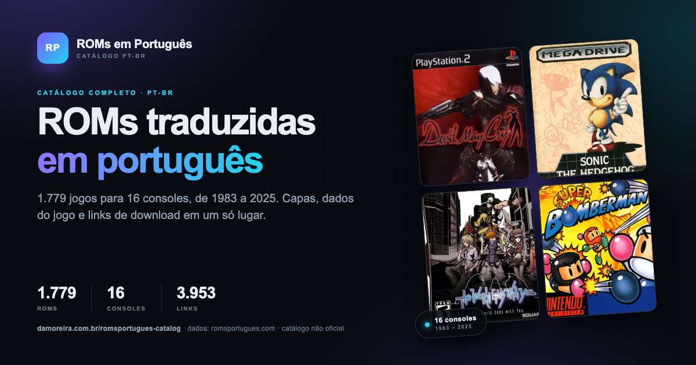

# romsportugues-catalog

[](https://github.com/gdamoreira/romsportugues-catalog/actions/workflows/pages.yml)
[](https://damoreira.com.br/romsportugues-catalog/)
[](LICENSE)

<p align="center">
  <a href="https://damoreira.com.br/romsportugues-catalog/">
    
  </a>
</p>

A static, read-only catalogue of the Portuguese-translated ROMs indexed by
[romsportugues.com](https://romsportugues.com/).

**Live site:** <https://damoreira.com.br/romsportugues-catalog/>

---

## Unofficial mirror — all data belongs to the original website

This repository is an **independent, unofficial mirror** of the catalogue
published at **romsportugues.com**.

All game data, cover images, download links, game titles, and trademarks
belong to **romsportugues.com** and their respective rights holders. No
ownership is claimed over any of it.

This project is **not affiliated with, endorsed by, or sponsored by**
romsportugues.com. It does **not** host or distribute ROM files. It only
mirrors catalogue metadata and links that are already publicly available on
the original website.

If you are a rights holder and want an entry, image, or link removed, see
[Data ownership & takedown](#data-ownership--takedown).

---

## What is this?

The repository turns the scraped catalogue into a fast, dependency-free
static website. Every ROM is displayed as a card with its cover, console,
year, developer, translator, players, genres, and download links.

- **1,779 entries** across **16 consoles** (1983–2025)
- **3,953 download links** mirrored from the original pages
- Instant client-side **search**, console/genre **filters**, and **sorting**
- Responsive **dark/light theme**
- Rich **Open Graph / Twitter link previews** with a 1200×630 card
- No backend, no database, no tracking, no external fonts or CDNs
- Works without JavaScript: every card is pre-rendered in the HTML

**Stack:** Python 3 (standard library only) + vanilla HTML/CSS/JS + GitHub
Actions. The social card is rendered with headless Chrome.

## Repository layout

```text
.
├── .github/workflows/pages.yml             # build + deploy to GitHub Pages
├── .github/workflows/refresh-catalog.yml   # manual scrape + rebuild + deploy
├── build_site.py                 # roms.csv -> site/
├── make_og_image.py              # roms.csv -> 1200x630 social card
├── scrape_roms.py                # romsportugues.com -> roms.csv
├── roms.csv                      # mirrored catalogue data (UTF-8 with BOM)
├── site_src/                     # source assets used by the generator
│   ├── app.js                    # search, filters, sort, theme
│   ├── styles.css                # layout and dark/light theme
│   ├── og-image.png              # 1200x630 social preview card
│   ├── favicon.svg
│   ├── favicon-32.png
│   ├── apple-touch-icon.png
│   ├── icon-192.png / icon-512.png
│   ├── mstile-150.png
│   ├── site.webmanifest
│   └── robots.txt
├── LICENSE                       # MIT (code only)
└── README.md
```

`site/` is generated and intentionally **not committed**. GitHub Actions
builds it on every push and publishes it as the Pages artifact.

## Run locally

Python 3.8+ is required. There is nothing to install.

```bash
git clone git@github.com:gdamoreira/romsportugues-catalog.git
cd romsportugues-catalog

python3 build_site.py --csv roms.csv --out site
python3 -m http.server 8000 --directory site
```

Open <http://localhost:8000>. You can also open `site/index.html` directly
in a browser.

The build writes `site/` and then runs a **minification post-phase** over
`index.html`, `assets/styles.css`, and `assets/app.js`. Source assets in
`site_src/` stay readable. Pass `--no-minify` to keep the output unminified
when debugging.

## Refresh the catalogue

### From GitHub Actions (manual only)

The workflow
[`.github/workflows/refresh-catalog.yml`](.github/workflows/refresh-catalog.yml)
does the whole refresh in CI. Its only trigger is **workflow_dispatch** — it
never runs on a schedule or on push.

1. Open **Actions → Refresh catalogue → Run workflow**.
2. Pick the number of parallel scraping workers.
3. The workflow will:
   - scrape the full catalogue,
   - validate the CSV (fails on any failed ROM page or fewer than 1,000 rows),
   - regenerate `site_src/og-image.png`,
   - build and minify the site,
   - commit `roms.csv` and `site_src/og-image.png` when they change,
   - deploy the freshly built site to GitHub Pages.

It uses the built-in `GITHUB_TOKEN` (`contents: write`, `pages: write`,
`id-token: write`) — no PAT is required. Because the bot push is made with
`GITHUB_TOKEN`, it does not trigger the normal `pages.yml` workflow; the
refresh workflow deploys its own artifact directly.

### From your machine

The scraper is polite by default: 8 workers, a global request delay, retries
on 429/5xx, and per-ROM error reporting.

```bash
# Re-scrape the full catalogue (112 listing pages, ~1,779 ROMs)
python3 scrape_roms.py --workers 8 -o roms.csv

# Rebuild the site
python3 build_site.py --csv roms.csv --out site
```

Useful flags for a quick check:

```bash
python3 scrape_roms.py --limit 12 -o test.csv
python3 scrape_roms.py --start-page 5 --end-page 5 -o page5.csv
```

### Social card

`make_og_image.py` regenerates the 1200×630 social card from the current CSV.
It reads the live totals (ROMs, consoles, year range, download links), picks
four covers, and falls back to branded placeholders if a cover is unavailable.
Headless Chrome/Chromium is required; there are no Python dependencies.

```bash
# After refreshing roms.csv
python3 make_og_image.py

# Custom paths
python3 make_og_image.py --csv roms.csv --out site_src/og-image.png
```

Set `CHROME_PATH` (or pass `--chrome`) if Chrome is not in a standard location.
Then rebuild the site with `build_site.py`.


### CSV schema

| Column | Meaning |
|---|---|
| `imagem` | Cover image URL |
| `nome` | Title as listed |
| `url` | Original ROM page |
| `dados_nome` … `dados_jogador` | "Dados do Jogo" fields |
| `download_N_label`, `download_N_url` | Download buttons, in page order |
| `erro` | Per-ROM scrape error (empty when OK) |

## Automatic deployment (GitHub Pages)

The workflow at [`.github/workflows/pages.yml`](.github/workflows/pages.yml)
runs on every push to `main` (and manually via **workflow_dispatch**):

1. Checks out the repository.
2. Sets up Python 3.12.
3. Runs `python3 build_site.py --csv roms.csv --out site --base-url …`,
   including the minification post-phase.
4. Uploads `site/` as the Pages artifact.
5. Deploys it to the `github-pages` environment.

Pages is already configured to deploy from GitHub Actions. For a fresh fork,
enable **Settings → Pages → Source: GitHub Actions** once.

The site is published at:

**<https://damoreira.com.br/romsportugues-catalog/>**

GitHub Pages fallback: <https://gdamoreira.github.io/romsportugues-catalog/>

All asset paths are relative, so the site works correctly under the
`/romsportugues-catalog/` base path.

The canonical URL, Open Graph `og:url`, and the absolute social image URL are
generated from `--base-url` (default:
`https://damoreira.com.br/romsportugues-catalog`). If you ever change domains,
update that value in the workflow and rebuild:

```bash
python3 build_site.py --base-url https://your-domain.example/catalogue
```

## Data ownership & takedown

The data in `roms.csv`, the cover images (loaded from the original website),
the download links, and all game titles and trademarks are the property of
**romsportugues.com** and their respective owners. This repository claims no
rights over them.

The **MIT license applies only to the original source code** in this
repository — the scraper, site generator, CSS, and JavaScript. It does **not**
apply to the scraped data, cover art, or download links.

If you are a rights holder and want an entry, image, or link removed, open an
issue titled **"Takedown request"** with the affected URL(s). Takedown
requests are handled; they are not contributions.

## Contributions

**No contributions are accepted.** This is a personal mirror project.

Pull requests will be closed without review. Feature requests, refactors, and
code contributions will not be implemented. Issues are reserved for takedown
and factual-correction requests only.

## License

The source code in this repository is released under the [MIT License](LICENSE).
The mirrored data, cover images, download links, and trademarks are **not**
covered by that license and remain the property of their respective owners.

## Credits

- Catalogue, metadata, covers, and download links:
  [romsportugues.com](https://romsportugues.com/)
- All game titles, cover art, and trademarks: their respective rights holders
- This mirror and its code: [gdamoreira](https://github.com/gdamoreira)
